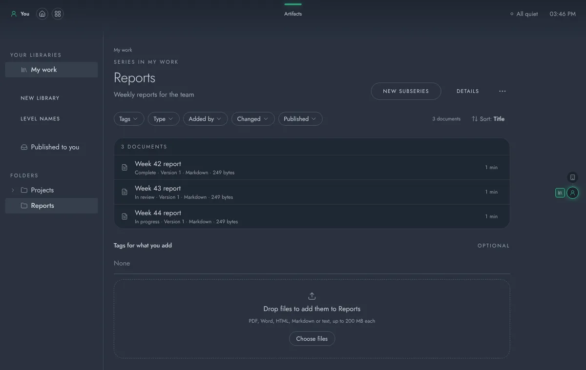
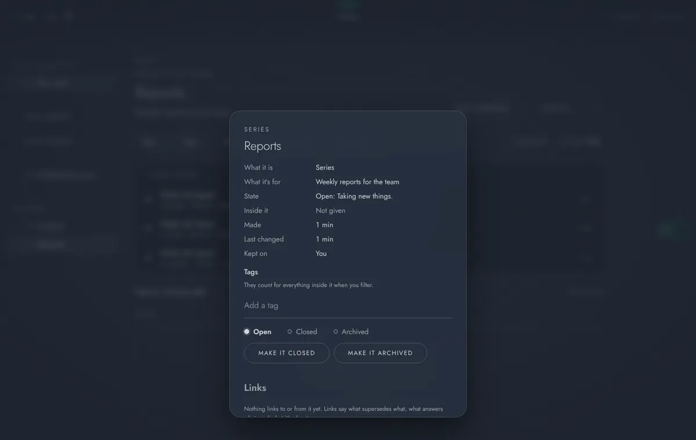
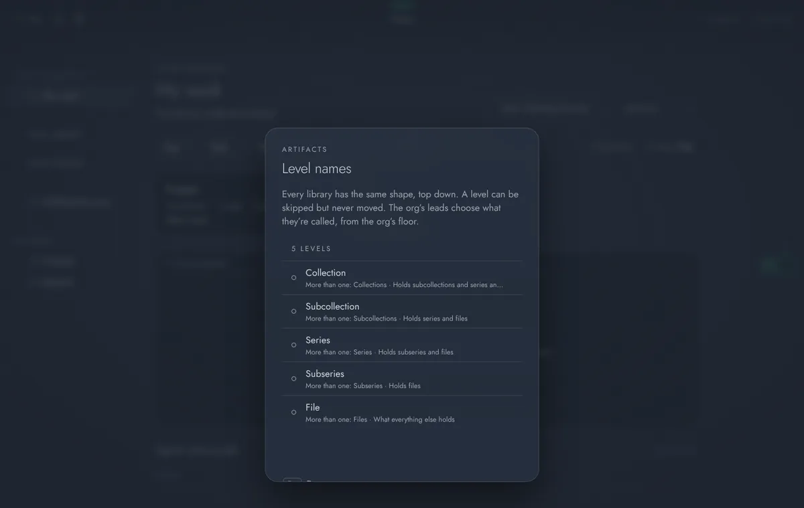
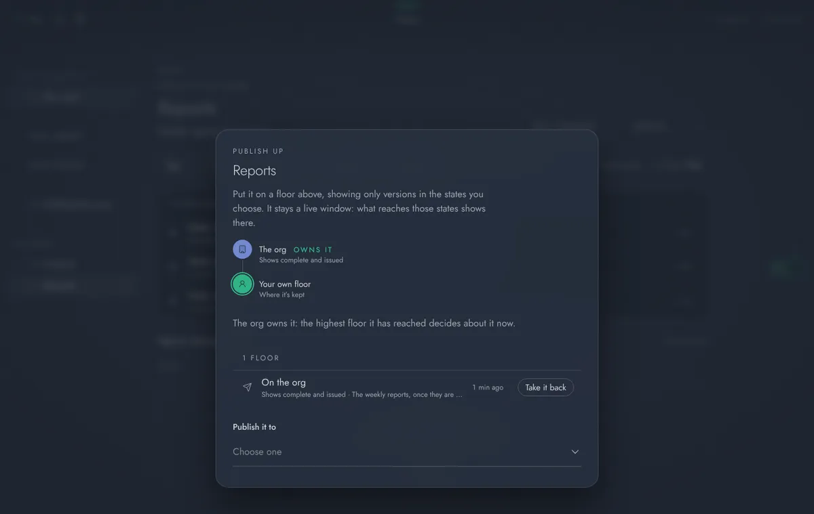

# Artifacts: a guide for people and admins

Artifacts is AUGUR's document libraries. (Its code name is Folio, which is still the name of its containers, its database schema and its address, `/folio`.) Every deployment runs it. It keeps a floor's documents in one place with the same shape everywhere, shows each one as a page you can read, and publishes them up the floors to the people who need them, in the states you choose.

The first half of this guide is for everyone who uses it. The second half is for admins. Artifacts lives in its own repository, [augur-folio](https://github.com/harry-burton-dev/augur-folio), which builds, signs and releases it; how it's built, and its API, are in its README there. Every AUGUR release ships the release of it that `release/shipped-apps.json` pins ([ADR 0049](decisions/0049-pillar-apps-shipped-from-their-releases.md)).

- [Using Artifacts](#using-artifacts)
  - [Getting around](#getting-around)
  - [Libraries and their shape](#libraries-and-their-shape)
  - [Adding documents](#adding-documents)
  - [Lifecycle](#lifecycle)
  - [Finding things](#finding-things)
  - [Reading](#reading)
  - [Sharing](#sharing)
  - [Publishing up the floors](#publishing-up-the-floors)
  - [Links](#links)
  - [Series](#series)
  - [From other apps](#from-other-apps)
- [Running Artifacts (admins)](#running-artifacts-admins)

## Using Artifacts

### Getting around

Every screen in Artifacts has the same three columns. Down the left is its own menu, the rail: **ARTIFACTS** at the top opens its front page, then **Your collections**, **Shared libraries** and, when something has come up from the floors below, **From below**. Under a rule is the collection you have open, with its folders, series and saved views. The rail folds down to a column of icons; point at one for its name. In the middle is what you're looking at, with **Back** above its title and a search above the grid. On the right, a drawer says what it is: what kind of unit, where it sits, what's inside, when it changed. It folds away too.

Actions aren't buttons on the page. **Right-click** anything (a collection, a folder, a document, or the empty space of the grid for the place you're in) for a ring of what you can do with it; the context-menu key does the same. Everything you can right-click answers the pointer, more strongly the higher it is: collections lift and light up, folders lift a little, documents only firm their edge. **Add**, above the grid, offers what can go in the place you're in.

The front page shows only what needs you (drafts waiting on a lead), what's new to you, and your collections.

Esc never takes you out of Artifacts. To get back to the menu of every app, press **Back** at the top left. The top bar stays on every screen: the floor you're on is at the top left, and Artifacts' name sits in the middle under the look-up handle.

What Artifacts shows is always the floor you're on. The floor gauge at the right edge lights that floor and pins Artifacts beside it; point at it to see every floor you can go to, who sees what's on each, and which one Artifacts is showing. Going to another floor keeps you in Artifacts, at the start of that floor's collections.

### The layout

Artifacts is built on Quill, AUGUR's React kit for apps, with depth and focus (PDR-010):

- **The front page** is a title card with three reels: **Actions** (drafts waiting on you as a lead, and series issues that are late), **New** (put out to you since you last looked) and **Upcoming** (the next issue each series expects). Actions and New pull their cards in one at a time behind a light; press the light, or a card to bring it forward, and again to open it. The page is built from a config (`ARTIFACTS_FRONT` in `frontend/src/quill/front.ts` in augur-folio, ``), the same one any app can use.
- **The rail** keeps your collections, Shared libraries, Published to you and From below. Inside a collection, the tree opens only along the path you took and lights it; everything beside the path dims.
- **Everything is a tile you walk into**, shaped by its kind: a collection is a block, a folder has a tab, a series is a stack, a document is a page. A document in review that's yours to move on has a ribbon.
- **Every action is in its radial menu.** Right-click (or long-press, or the context-menu key, or Shift+F10) any tile, any row in the tree, a card on the front page, or the empty space between tiles. What you can't do stays in the ring, greyed, and says why. While the ring is open the rest of the app goes out of focus in place, with the thing you chose kept sharp.
- **Find** with `/` from anywhere.
- Dialogs rack the app out of focus behind them, rather than covering it with a dark scrim.

Filters, saved views, tags, level names, series, details, links, reading, sharing and publishing are all in this layout. The classic layout (Lit) is gone; a device that had chosen it opens this one.

The alternatives PDR-010 proposes are one setting away in code: the plain front page look (`look: 'plain'`), quiet rather than blurred ambient cards (`ambience: 'quiet'`), all of Actions at once (`reveal: 'all'`), and the `lens` or `scrim` depth for desktops without a GPU.

### Libraries and their shape

A library belongs to the floor it was made on: your own floor, a team's, or the org's. Everyone who can stand on that floor can read it and add to it, and the floor's leads manage it. Open Artifacts from its chapter in the menu of every app, or from its card on Home.

Every library has the same shape, top down. Each place in it is a **unit**:

| Level | What it is | Holds |
| --- | --- | --- |
| **Collection** | The library itself | Subcollections, series and files |
| **Subcollection** | A part of it, such as Projects | Series and files |
| **Series** | A run of things that belong together, such as weekly Reports | Subseries and files |
| **Subseries** | A part of a series | Files |
| **File** | A document, with all its versions | |

A level can be skipped (a file can sit straight in the collection) but never moved: a series never holds a subcollection. The org's leads can rename the levels for the whole org, from the org's floor, with **Level names**: right-click the empty space on **Your collections**. Everyone else sees what they're called there. A new name changes only the words, never the shape.

(The screenshots in this guide are from before the three-column layout; the screens hold the same things.)

- **New collection** makes one (a floor's leads): the dashed tile after the last one, or **Add** on Your collections. Give it a name and, if you like, a line saying what it's for.
- **New subcollection**, **New series** and so on make the next level down inside the one you're in, from **Add** or by right-clicking the grid. Only the levels that fit are offered. A unit can be removed once it's empty: right-click it.
- **Details** (right-click the grid) shows a unit's metadata, its tags, its links, and its state: Open, Closed (kept as it is, nothing new goes in) or Archived. Whoever manages the collection moves it on.
- **Archive** (right-click a collection) takes it off the floor's list. It deletes nothing.

The rail shows the open collection's folders, saved views and series. What's been shared with you from other floors is under **Shared libraries**, with **Published to you** at its foot.

### Adding documents

Press **Add**, then **Add files**, and choose them. They go into the place you're in. Artifacts takes PDF, Word (.docx), HTML, Markdown and plain text. A file can be up to 200 MB, unless an admin has set a lower limit. Tag them once they're in, from **Change it** on each.

Artifacts keeps every file exactly as it was uploaded. Dropping a new file on a document adds it as the next version, and every earlier version stays, so it can still be downloaded. **Change it** retitles a document, moves it to another folder, or changes its tags.

Deleting a document takes it out of the library straight away. Its files are kept for a while (30 days, unless an admin changes it) and then removed for good. The activity log still names it after that.

### Lifecycle

Each version of a file has a lifecycle state, shown on its row and in the reader:

- **In progress**: being worked on. Every new file starts here.
- **In review**: ready for someone to check.
- **Complete**: done.
- **Issued**: the version that's out, for people to act on.
- **Retired**: no longer in use. It's kept, with its history.

Anyone who can change a file moves its newest version between In progress, In review and Complete. Issuing and retiring need manage on it. Every move is kept on its record. Publishing up uses these states: you choose which ones a floor above sees.

### Finding things

The bar above the list narrows it down:

- by **tags** (documents have to carry all of the ones you choose),
- by **type** of file,
- by who **added** it,
- by when it last **changed**,
- by its **lifecycle** state,
- by whether it's **published**,
- by **series**.

Once a filter is on, the list looks in every folder below the one you're in. **Sort** orders it by title, newest, recently changed, or a series' period.

A set of filters can be saved as a **view**, which sits in the side rail for everyone using the library. "Policies in draft" is one example.

There are two kinds of tag. Every library shares **the org's tags**, such as Policy or Finance, which the leads on the org's floor keep. Each library can also have **its own tags**. A library's leads can let anyone in the library add tags. A folder can carry tags too, in its **Details**: they count for everything inside it when you filter.

To look everywhere at once, open the centre menu (Ctrl K, or ⌘K on a Mac) and choose **Find**. It searches the titles, tags and text of every document you can read, along with everything that has been published to you.

### Reading

Opening a document shows it as a page of text. This is its **reader copy**, which Artifacts makes from the file, so it's the same whether the original was a PDF, a Word file or a web page. The headings make up the contents down the side, which follow along as you read. Use **Smaller** and **Larger** to change the text size, and **Wide page** to give long tables more room. Artifacts remembers where you were in a document.

**Back**, above the title, names where the file sits and goes back there. The drawer on the right has the version's lifecycle state (move it on from there), **Publish up the floors**, its versions and its **Links**.

**Download the original** gives you the file exactly as it was uploaded. Each heading and paragraph has its own address, so you can link straight to part of a document.

To tell Data Atlas about something a document names, such as a ship, a port, a person or an organisation, select the words and choose **Add to Data Atlas** in the drawer. Data Atlas asks what kind of thing it is and sends it to your floor's Triage, where a lead decides what it is. Nothing is added to what's known until they do.

It can take a moment to make a reader copy. If one couldn't be made, the page says so, and whoever can change the document can ask for it to be made again.

### Sharing

Anyone who manages a library, a folder or a document can let others in with **Share**. You can share with a person, a team, a team and the teams below it, or the whole org, and choose how far they get in:

| | Read | Edit | Manage |
| --- | --- | --- | --- |
| Read it and download the original | yes | yes | yes |
| Add documents, folders and versions, and change any document | | yes | yes |
| Share it, rename or archive it | | | yes |

Whoever manages a library can also share one folder with **Share** inside it. Whoever it's shared with sees everything inside that folder, the folders below it too, for as long as it stays inside: a document moved out of the folder is no longer shared with them. They find it under **Shared libraries**, and the collection itself stays closed to them. A document's **Share** lists anyone who reaches it through a folder it's in, and the floors it's **Published up to**, each with the floors it came up through and the states it shows there.

Whatever has been shared with you appears under **Shared libraries** on every floor of yours: one library for each floor or person that shared something, opening on what they shared, and documents shared on their own beside them. Anyone who can see something can also see who else can. **Who can open this, explained** opens Explorer over Artifacts: each person and team with how many people that is, how it reaches them (its floor, its library, a folder it's in, shared with it alone, or published up, with the floors it came through and what it shows), and everyone else at the org who can't.

### Publishing up the floors

Any unit, from a single file to a whole collection, can be **published up** to a floor above the one it's on: a team you're in, a team above that, or the org. Press **Publish up** on a place, or **Publish up the floors** in the reader. Choose the floor, and choose which lifecycle states it shows there: say Complete and Issued for the org, or everything but Retired for your own team.

- **It's a live window, not a copy.** New files, and new versions, show up there by themselves as they reach the states you chose. Publishing a series publishes everything in it, now and later.
- **Further up.** A floor that received something can publish it on up, but never showing more than it was shown.
- **One owner.** The highest floor it has reached owns it and decides about it from then on. While it's only on its own floor, its own floor does. Owning it doesn't move the right to change the files: they stay with whoever can edit them where they were made. The whole chain, who published it, from where, to where, when and showing what, is kept.
- **One place.** Everyone sees a published unit in one place only: the highest floor it reaches them on. The floors below it don't hide it; they say where it went.
- **Taking it back** from a floor takes it back from every floor it went on to from there. Artifacts says which before it does.

Everyone on the floor it goes to is told once, when it first arrives. There it waits under **From below** until one of the floor's leads gives it a place in their library, where its level fits.

Whoever manages a unit publishes it up from its own floor; a floor that received it publishes it on up through its leads, from that floor. Publishing to the org needs the **publisher** role.

What was published the old way before (one version out to an audience) is moved onto publishing up by itself, soon after the upgrade. A team or the org above the document's floor gets it published up, showing Issued. Its own floor and the teams below it already see it. Anyone else it went to, such as a team beside it, keeps it as a share. The old publication ends with "Moved onto publishing up the floors." on its record.

A series' issues are the exception: each new issue still goes out to the series' audience, one version at a time.

- Press **Publishing** on the issue to choose the version and the audience. You can add a note, which goes out with the notice.
- Publishing it again replaces what was out with the new version.
- **Withdraw** takes it back. You can give a reason.

Every time something was published stays on its record. To show one person a document, share it with them instead.

**Published to you**, at the foot of Shared libraries, lists everything that has been put out to you, newest first. Artifacts' card on Home says how much is new since you last looked. For a floor's leads, it also says how many drafts are waiting.

### Links

A unit can be linked to other things, from its **Details** or the reader's **Links**: another unit in Artifacts (**relates to**, **supersedes**, **responds to**), a thing in Data Atlas (**about**, such as a ship), or an intent in Mandate (**serves**). The link reads both ways: the other end shows what links to it. A linked thing you can't open stays in the list and says so. Whoever can change a unit adds and removes its links.

### Series

A **series** is a run of documents that comes out on a schedule, such as a weekly cash report. Its schedule can be weekly, monthly, quarterly, or now and then. Whoever manages the library sets one up with **New series**, choosing its tags and the audience each issue goes to.

To add the next issue, drop its file on the series' page. Artifacts names it ("Cash report: Week 46, 2026"), numbers it and tags it. If you're allowed to publish to the series' audience, Artifacts also publishes it. Anyone else's issue waits as a draft. When an issue is late, the person who made the series is told.

Turn on **Tell me of each new issue** to be told each time an issue comes out. In the reader, an issue shows the ones before and after it.

### From other apps

Other apps can open Artifacts' documents, libraries and units (`unit.open`, at any level), and ask you to pick a document. When an app asks for a document, Artifacts opens over it as a picker. Find one by typing, or look through a library. Only the kinds of file that app can take are offered.

## Running Artifacts (admins)

Artifacts ships with AUGUR. Its service, its rendition worker and its frontend are part of every release and change version with it, and it registers itself in **Admin → Apps** when it starts. You don't need to install or allow anything. Setting it up on a server takes three secrets in `.env`: `FOLIO_CLIENT_SECRET`, `FOLIO_DATABASE_PASSWORD` and `FOLIO_BUCKET_SECRET` (see [deploy.md](deploy.md) and, for an existing server, [upgrade.md](upgrade.md)).

All of the following are in **Admin → Apps → Artifacts** unless it says otherwise.

| To… | Do this |
| --- | --- |
| Turn Artifacts off, or back on | Turn it off for the whole org, or set each floor to **On here and below**, **Off here and below**, or **As the floor above**. Everyone's own floor follows the org. Turning it off hides it and keeps everything; Artifacts can't be removed. |
| Limit the size of uploads | Choose a **Largest upload** below Artifacts' 200 MB. |
| Keep deleted documents for longer or shorter | Set **Keep deleted documents for** (1 to 3650 days; 30 if you leave it empty). Artifacts checks every hour. Past that time, a deleted document's files and text are removed for good. Every change is recorded in the activity log. |
| Let someone publish to the whole org | Give them the **publisher** role in **Admin → People**. |
| Keep the org's tags | The leads on the org's floor do this from **Tags** (right-click the grid) in any collection on the org's floor. |

**Where things are kept.** Documents' details live in Artifacts' own schema (`folio`) in the database. The files themselves (originals, reader copies, thumbnails and pictures) live in Artifacts' own bucket. The nightly backup takes both ([deploy.md](deploy.md#backups)). This means a document removed after its retention period stays in older backups until they age out (`BACKUP_KEEP_DAYS`, 14 days by default).

**Reader copies.** The `folio-worker` container makes them, using Docling, one version at a time. If documents stay at "Making the reader copy…" for a long time, check that the container is running and look at its logs (`pc logs folio-worker`). A copy that failed can be asked for again from its document.

**On the record.** Artifacts writes to the platform's activity log. Each of these is recorded:

- a library made or archived,
- a document uploaded, versioned, deleted, published or withdrawn,
- every change to who can see something,
- every download of an original,
- every document removed for good.

The log names who did it and where.
