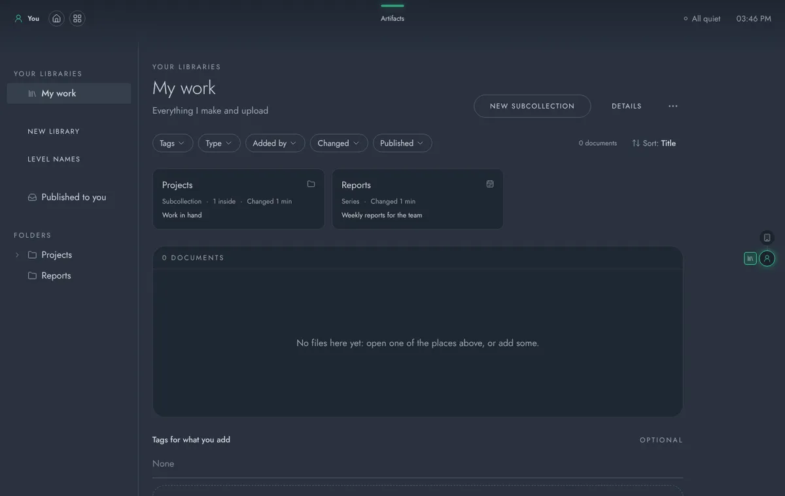
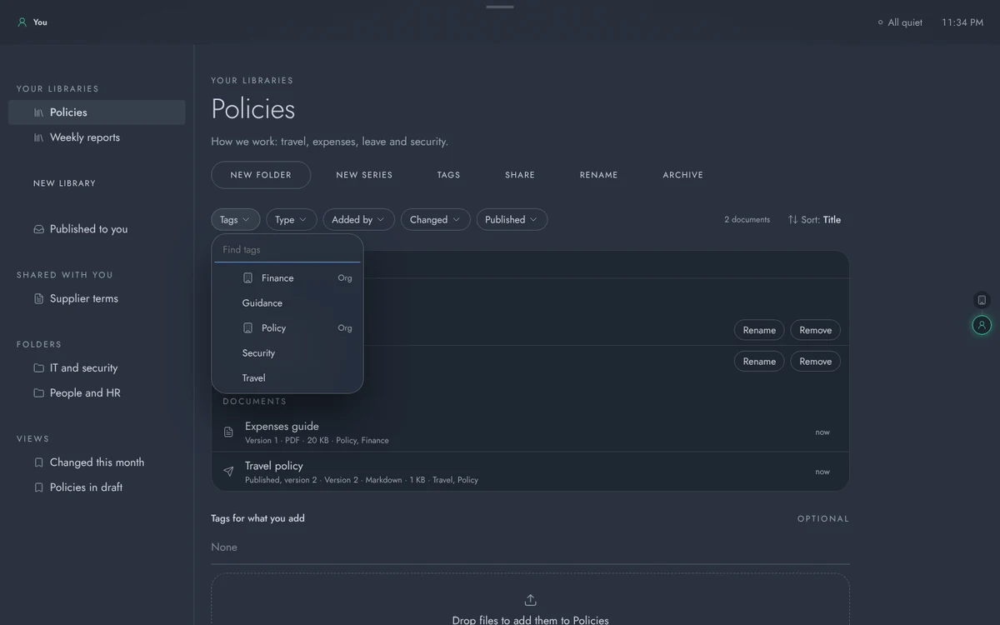
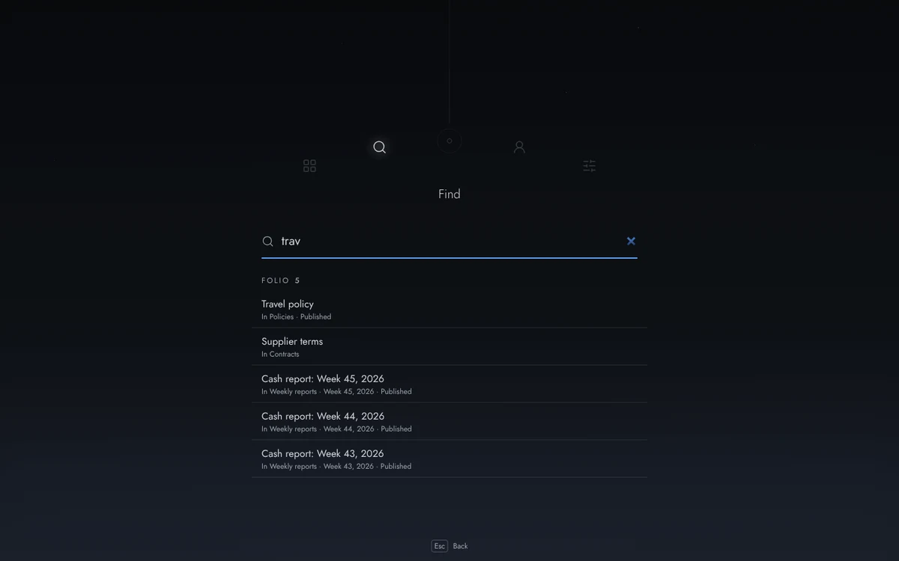
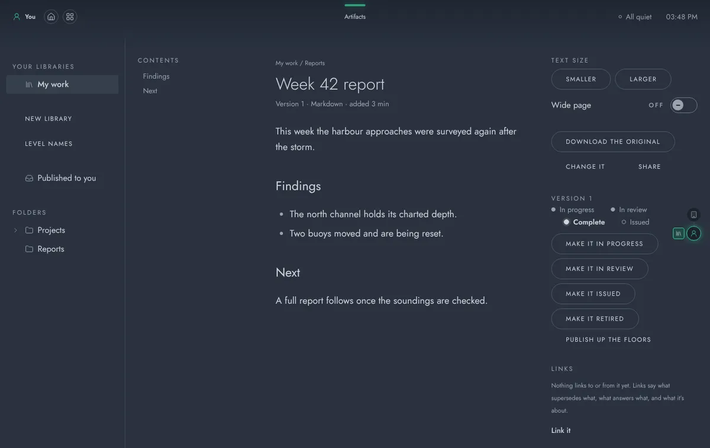
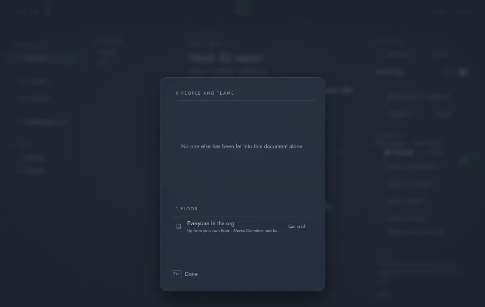
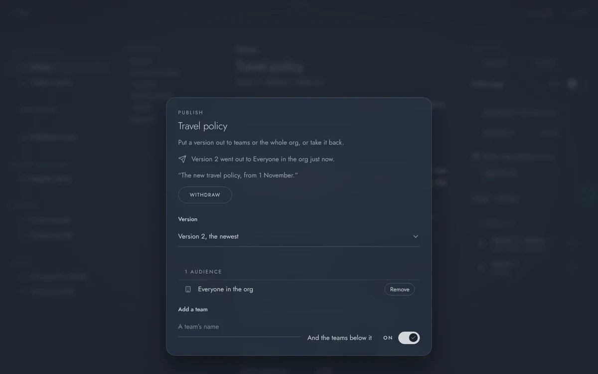
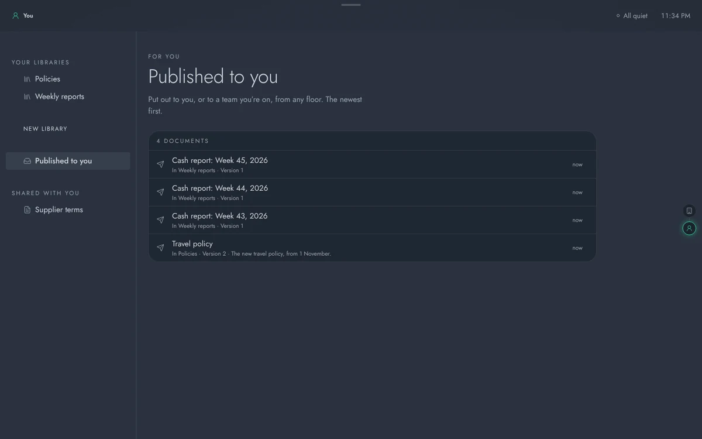
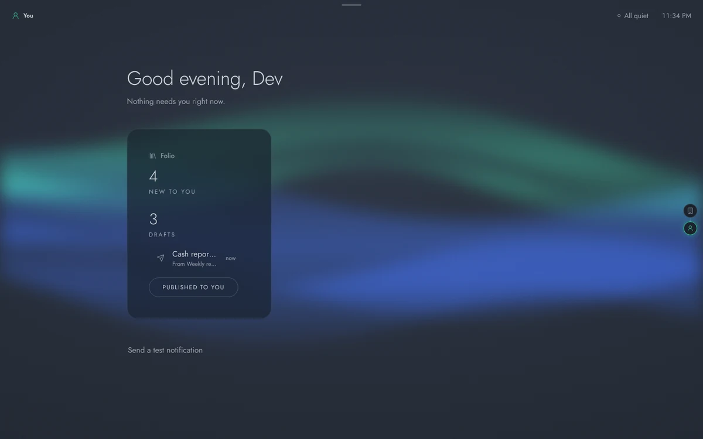
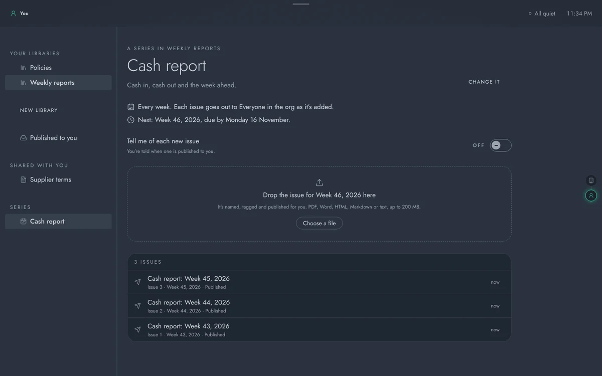
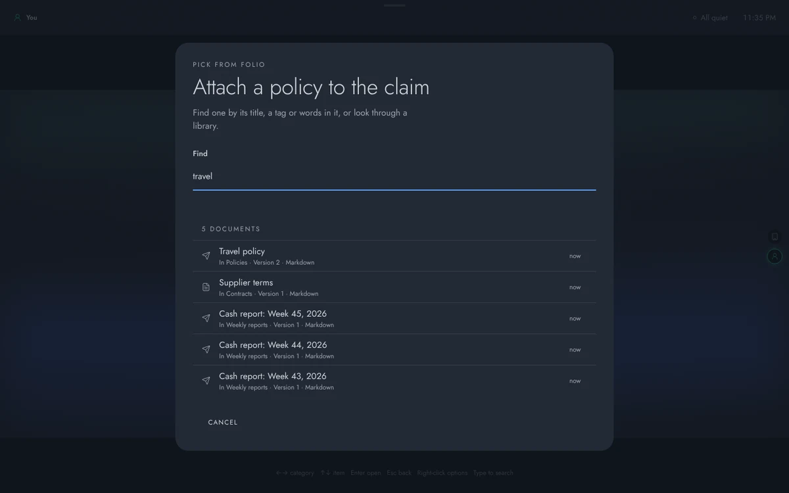

# Artifacts: a guide for people and admins

Artifacts is AUGUR's document libraries. (Its code name is Folio, which is still the name of its containers, its database schema and its address, `/folio`.) Every deployment runs it. It keeps a floor's documents in one place, shows each one as a page you can read, and puts the finished ones out to the people who need them.

The first half of this guide is for everyone who uses it. The second half is for admins. How Artifacts is built, and its API, are in [its README](../apps/folio/README.md).

- [Using Artifacts](#using-artifacts)
  - [Getting around](#getting-around)
  - [Libraries and folders](#libraries-and-folders)
  - [Adding documents](#adding-documents)
  - [Finding things](#finding-things)
  - [Reading](#reading)
  - [Sharing](#sharing)
  - [Publishing](#publishing)
  - [Series](#series)
  - [From other apps](#from-other-apps)
- [Running Artifacts (admins)](#running-artifacts-admins)

## Using Artifacts

### Getting around

Artifacts opens straight into its own menu down the side: the floor's libraries, what's been published or shared with you, and the open library's folders, views and series. Esc never takes you out of it. To get back to the menu of every app, press **Back** at the top left. The top bar stays on every screen: the floor you're on is at the top left, and Artifacts' name sits in the middle under the look-up handle.

What Artifacts shows is always the floor you're on. The floor gauge at the right edge lights that floor and pins Artifacts beside it; point at it to see every floor you can go to, who sees what's on each, and which one Artifacts is showing. Going to another floor keeps you in Artifacts, at the start of that floor's libraries.

### Libraries and folders

A library belongs to the floor it was made on: your own floor, a team's, or the org's. Everyone who can stand on that floor can read it and add to it, and the floor's leads manage it. Open Artifacts from its chapter in the menu of every app, or from its card on Home.

- **New library** makes one (a floor's leads). Give it a name and, if you like, a line saying what it's for.
- **New folder** makes a folder at the top, or inside the folder you're in, up to six deep. A folder can be removed once it's empty.
- **Archive** takes a library off the floor's list. It deletes nothing.

The side rail shows the floor's libraries. Under them are what's been published to you, what's been shared with you from other floors, and the open library's folders, saved views and series.

### Adding documents

Drop files on the library, or press **Choose a file**. Artifacts takes PDF, Word (.docx), HTML, Markdown and plain text. A file can be up to 200 MB, unless an admin has set a lower limit. The tags under **Tags for what you add** go on everything you drop.

Artifacts keeps every file exactly as it was uploaded. Dropping a new file on a document adds it as the next version, and every earlier version stays, so it can still be downloaded. **Change it** retitles a document, moves it to another folder, or changes its tags.

Deleting a document takes it out of the library straight away. Its files are kept for a while (30 days, unless an admin changes it) and then removed for good. The activity log still names it after that.

### Finding things

The bar above the list narrows it down:

- by **tags** (documents have to carry all of the ones you choose),
- by **type** of file,
- by who **added** it,
- by when it last **changed**,
- by whether it's **published**,
- by **series**.

Once a filter is on, the list looks in every folder below the one you're in. **Sort** orders it by title, newest, recently changed, or a series' period.

A set of filters can be saved as a **view**, which sits in the side rail for everyone using the library. "Policies in draft" is one example.

There are two kinds of tag. Every library shares **the org's tags**, such as Policy or Finance, which the leads on the org's floor keep. Each library can also have **its own tags**. A library's leads can let anyone in the library add tags.

To look everywhere at once, open the centre menu (Ctrl K, or ⌘K on a Mac) and choose **Find**. It searches the titles, tags and text of every document you can read, along with everything that has been published to you.

### Reading

Opening a document shows it as a page of text. This is its **reader copy**, which Artifacts makes from the file, so it's the same whether the original was a PDF, a Word file or a web page. The headings make up the contents down the side, which follow along as you read. Use **Smaller** and **Larger** to change the text size, and **Wide page** to give long tables more room. Artifacts remembers where you were in a document.

**Download the original** gives you the file exactly as it was uploaded. Each heading and paragraph has its own address, so you can link straight to part of a document.

It can take a moment to make a reader copy. If one couldn't be made, the page says so, and whoever can change the document can ask for it to be made again.

### Sharing

Anyone who manages a library, or a document, can let others in with **Share**. You can share with a person, a team, a team and the teams below it, or the whole org, and choose how far they get in:

| | Read | Edit | Manage |
| --- | --- | --- | --- |
| Read it and download the original | yes | yes | yes |
| Add documents, folders and versions, and change any document | | yes | yes |
| Share it, rename or archive it | | | yes |

Whatever has been shared with you appears under **Shared with you** on every floor of yours. Anyone who can see something can also see who else can. **Who can open this, explained** opens Auspex over Artifacts: each person and team with how many people that is, how it reaches them (its floor, its library, or shared with it alone), and everyone else at the org who can't.

### Publishing

A document is a **draft** until it's published. Publishing puts one version out to an audience: a team, a team and the teams below it, or the whole org. Everyone in that audience can then read that version, and only that version, from their own floor, even if they can't see the library. Each of them is told about it, with a **Read** button that opens it.

- Press **Publishing** on the document to choose the version and the audience. You can add a note, which goes out with the notice.
- Publishing it again replaces what was out with the new version.
- **Withdraw** takes it back. You can give a reason.

Every time a document was published stays on its record.

A team's leads publish to their own team and the teams below it, and the org's leads publish to any team. Publishing to the whole org, to teams beyond your floor, or from your own floor needs the **publisher** role. To show one person a document, share it with them instead.

**Published to you** lists everything that has been put out to you, newest first. Artifacts' card on Home says how much is new since you last looked. For a floor's leads, it also says how many drafts are waiting.

### Series

A **series** is a run of documents that comes out on a schedule, such as a weekly cash report. Its schedule can be weekly, monthly, quarterly, or now and then. Whoever manages the library sets one up with **New series**, choosing its tags and the audience each issue goes to.

To add the next issue, drop its file on the series' page. Artifacts names it ("Cash report: Week 46, 2026"), numbers it and tags it. If you're allowed to publish to the series' audience, Artifacts also publishes it. Anyone else's issue waits as a draft. When an issue is late, the person who made the series is told.

Turn on **Tell me of each new issue** to be told each time an issue comes out. In the reader, an issue shows the ones before and after it.

### From other apps

Other apps can open Artifacts' documents and ask you to pick one. When an app asks for a document, Artifacts opens over it as a picker. Find one by typing, or look through a library. Only the kinds of file that app can take are offered.

## Running Artifacts (admins)

Artifacts ships with AUGUR. Its service, its rendition worker and its frontend are part of every release and change version with it, and it registers itself in **Admin → Apps** when it starts. You don't need to install or allow anything. Setting it up on a server takes three secrets in `.env`: `FOLIO_CLIENT_SECRET`, `FOLIO_DATABASE_PASSWORD` and `FOLIO_BUCKET_SECRET` (see [deploy.md](deploy.md) and, for an existing server, [upgrade.md](upgrade.md)).

All of the following are in **Admin → Apps → Artifacts** unless it says otherwise.

| To… | Do this |
| --- | --- |
| Turn Artifacts off, or back on | Turn it off for the whole org, or set each floor to **On here and below**, **Off here and below**, or **As the floor above**. Everyone's own floor follows the org. Turning it off hides it and keeps everything; Artifacts can't be removed. |
| Limit the size of uploads | Choose a **Largest upload** below Artifacts' 200 MB. |
| Keep deleted documents for longer or shorter | Set **Keep deleted documents for** (1 to 3650 days; 30 if you leave it empty). Artifacts checks every hour. Past that time, a deleted document's files and text are removed for good. Every change is recorded in the activity log. |
| Let someone publish to the whole org | Give them the **publisher** role in **Admin → People**. |
| Keep the org's tags | The leads on the org's floor do this from **Tags** in any library on the org's floor. |

**Where things are kept.** Documents' details live in Artifacts' own schema (`folio`) in the database. The files themselves (originals, reader copies, thumbnails and pictures) live in Artifacts' own bucket. The nightly backup takes both ([deploy.md](deploy.md#backups)). This means a document removed after its retention period stays in older backups until they age out (`BACKUP_KEEP_DAYS`, 14 days by default).

**Reader copies.** The `folio-worker` container makes them, using Docling, one version at a time. If documents stay at "Making the reader copy…" for a long time, check that the container is running and look at its logs (`pc logs folio-worker`). A copy that failed can be asked for again from its document.

**On the record.** Artifacts writes to the platform's activity log. Each of these is recorded:

- a library made or archived,
- a document uploaded, versioned, deleted, published or withdrawn,
- every change to who can see something,
- every download of an original,
- every document removed for good.

The log names who did it and where.
